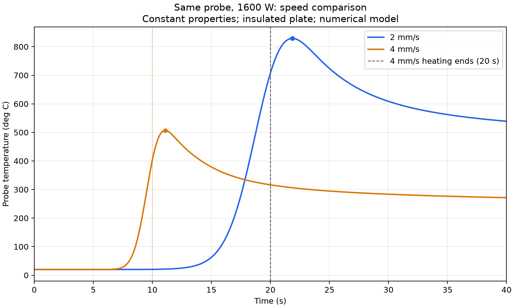

# 焊接速度对测点温度的影响

## 研究问题

本实验比较 2 mm/s 和 4 mm/s 两种焊接速度下，同一测点的温度变化。固定的是热源功率 1600 W，以及材料的常物性、热源移动距离和边界条件。两组路径相同，速度改变了加热时长，名义总热输入因此不同：2 mm/s 为 64 kJ，4 mm/s 为 32 kJ。改变的条件是热源移动速度，以及随之改变的热源存在时间。

## 模型与工况

详细参数见 `model_definition.md`。板材尺寸为 100 mm × 40 mm × 10 mm。热源加在顶面 `TOP_HEAT` 上，沿直线从 10 mm 移动到 90 mm。测点在该平面上，坐标为 (50, 10, 28) mm，距焊道中心线 8 mm。两组都从 10 mm 处、0 s 开始加热，并在热源到达终点时停热：2 mm/s 加热 40 s，4 mm/s 加热 20 s。两组的观测都到 40 s。

## 结果

同一测点、1600 W 下，2 mm/s 的峰值更高，最高采样时刻也更晚。热源中心经过测点所在横截面的时刻，2 mm/s 为 20 s，4 mm/s 为 10 s。最高采样时刻晚于这个时刻。2 mm/s 有两个并列的最高采样时刻，21.853 s 和 21.878 s，峰温为 829.13 °C。4 mm/s 的最高采样时刻为 11.103 s，峰温为 506.78 °C。慢组加热更久，名义热输入更高，热源在测点附近停留更久，所以峰值更高。

40 s 时两组测点温度都已越过峰值。4 mm/s 组在 20 s 已经停热，又过了 20 s；2 mm/s 组到 40 s 才结束加热。此时温度分别是 2mm/s组别是 539.02 °C 和 4mm/s组别是 271.56 °C。

| 速度 | 最高采样时刻 | 峰值温度 | 40 s 温度 |
|---|---|---|---|
| 2 mm/s | 21.853 s、21.878 s | 829.13 °C | 539.02 °C |
| 4 mm/s | 11.103 s | 506.78 °C | 271.56 °C |

## 储热核查

这项核查只看 4 mm/s 组停热之后。该组 20 s 和 40 s 的整板储热都约为 31,997.68 J，差值落在导出舍入误差界内。这支持停热后热量主要在板内重新分布，整板储热不再增加。测点温度仍可下降，是因为热量继续传向周围较冷区域。

两组复跑的探针导出分别与归档逐字节一致，说明在相同设置下测点结果可以复现。

## 局限

模型采用绝热边界和常物性，并忽略相变。这些设定限制了真实散热和熔化条件下的定量预测。目前缺少实验验证，仿真温度不能直接当作实测温度。两组速度下温度高低和出现早晚的比较，只说明当前数值模型中的差异。

## 个人工作

板材建模、材料与初温、网格和测点设置，以及两组求解和温度导出，是自己完成的。移动热源的 APDL 命令来自助手提供的脚本，自己按组别修改了其中的速度等参数。施热和撤热的载荷步是在指导下修正的：4 mm/s 组使用两个载荷步，第 1 步施加顶面热源，第 2 步在 20 s 删除热通量并计算到 40 s；2 mm/s 组只有一个载荷步，结束时间为 40 s，速度取 0.002 m/s。
